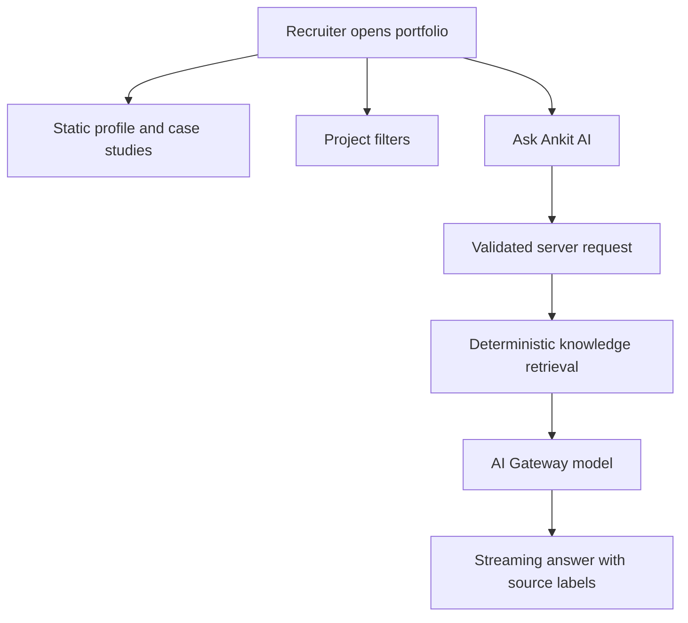

# Architecture

## Recruiter experience

The home page is statically rendered for speed and search visibility. Interactive project filtering and the portfolio assistant hydrate only the client components that need browser state.

## AI request path

1. The browser submits a bounded conversation to `POST /api/chat`.
2. The route rejects oversized payloads, excessive conversation history, and overlong questions.
3. An approximate in-memory limiter reduces casual abuse. For sustained public traffic, replace it with a durable rate limiter such as Upstash Redis or a platform-level rule.
4. The latest recruiter question is tokenized and scored against the curated chunks in `lib/profile.ts`.
5. The top evidence is placed into a constrained system prompt.
6. Vercel AI Gateway handles the model request and streams the result back through the AI SDK UI protocol.

## Why there is no vector database

The current knowledge base is small and changes infrequently. Keyword retrieval is faster to audit, adds no storage dependency, and avoids embedding cost. A vector database becomes useful only if the corpus expands to many long project documents, talks, articles, or code explanations.

## Reliability and privacy decisions

- The assistant answers only from curated public facts.
- Source labels are part of the response contract.
- Output is capped to keep answers concise and costs bounded.
- The browser never receives an AI credential.
- The assistant excludes sensitive personal and confidential client information.
- The portfolio remains fully useful if the AI route is unavailable.

## Production hardening path

For higher traffic, add a durable IP or session rate limiter, bot detection, explicit per-project AI Gateway budgets, error telemetry without prompt logging, and a small evaluation suite covering factuality, refusal behavior, and prompt injection.
